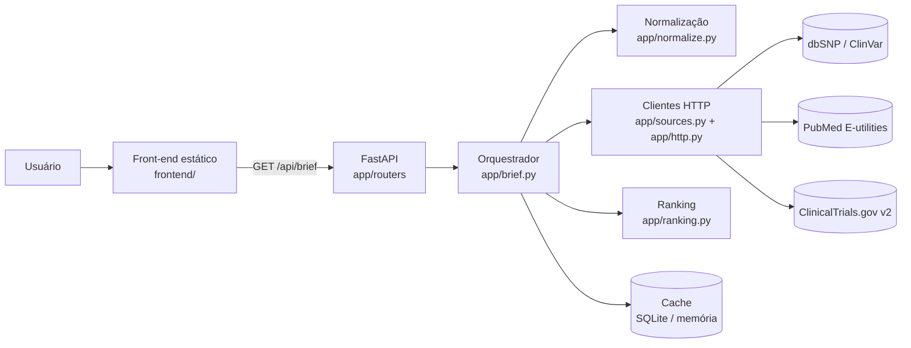

# VariantScope

> Da variante genômica ao panorama de ensaios clínicos — com fontes rastreáveis, sem "achados" inventados por IA.

**VariantScope** é uma aplicação full-stack que recebe um rsID (`rs113488022`) ou uma alteração proteica
(`BRAF V600E`, `BRAF p.Val600Glu`) e devolve um **brief de pesquisa**: resolução da variante, significado
ClinVar, literatura PubMed graduada por nível de evidência e o cenário de ensaios do ClinicalTrials.gov —
com status, fase, país, ano de início e *link para o registro original*.

Cada afirmação é rastreável a um PMID, NCT ou rsID. O projeto não escreve conclusões médicas automáticas:
a presença de uma variante em um ensaio **não** implica elegibilidade nem eficácia.

---

## Funcionalidades

- **Entrada flexível**: `rs113488022`, `113488022`, `BRAF V600E`, `braf p.Val600Glu`, `BRAF:p.V600E`, `KRAS G12C`, `EGFR p.(Leu858Arg)`.
- **Resolução via dbSNP/ClinVar** com avisos de rsID mesclado, isoforms alternativas e variantes não codificantes.
- **Busca no PubMed** com strings explícitas, artigos retractados sinalizados e níveis de evidência
  (revisão › ensaio clínico randomizado › estudo clínico › relato de caso › outro).
- **Ranking de ensaios por relevância**:
  - variante exata › mesmo códon › apenas gene › apenas condição;
  - menção em **critério de exclusão** ou como *wild-type/negative* nunca conta como match e vira alerta;
  - status separados (`Recruiting` ≠ `Not yet recruiting`), fase, país e ano de início.
- **Degradação graciosa**: se uma fonte falha, as outras continuam e a interface mostra o status de cada uma.
- **Cache TTL** em SQLite (Docker/local) ou memória (Vercel), com chave SHA-256 **sem o texto da consulta**.
- **Modo demo offline** (`VTS_DEMO=1`): dados sintéticos, banner visível e links externos desabilitados.
- **API documentada** (OpenAPI/Swagger), healthcheck, JWT para endpoints administrativos, CORS opcional,
  rate limit por IP, CSP e cabeçalhos de segurança.
- **Front-end responsivo** em HTML/CSS/JS puro: PT/EN, perfil *paciente*/*clínico*, filtros, tabela,
  exportação CSV, tema claro/escuro persistente e atalho `/` para focar a busca.

---

## Arquitetura



**Separação de responsabilidades**

| Camada | Diretório | Papel |
|---|---|---|
| Apresentação | `frontend/` | Interface estática, i18n, filtros e renderização |
| API | `app/routers/` | Rotas finas, validação de query, tradução de erros |
| Domínio | `app/brief.py`, `normalize.py`, `ranking.py`, `sources.py` | Regras clínicas e parsers |
| Infra | `app/http.py`, `cache.py`, `config.py`, `security.py` | HTTP com retry/rate limit, cache, segredos, JWT |
| Runtime | `api/index.py`, `Dockerfile`, `vercel.json`, `render.yaml` | Serverless, container e PaaS |

---

## Tecnologias

- **Python 3.11+** · FastAPI · Uvicorn · Pydantic · httpx · PyJWT · Mangum
- **SQLite** (cache persistente) · cache em memória no serverless
- **Front-end**: HTML5, CSS3, JavaScript ES6 (sem build, sem framework)
- **Infra**: Docker, Docker Compose, Vercel, Render, GitHub Actions, Dependabot, Ruff, pytest
- **APIs externas**: NCBI Variation Services, NCBI E-utilities, ClinicalTrials.gov API v2

---

## Instalação e execução

### 1. Local (desenvolvimento)

```bash
git clone https://github.com/JNeves07/VariantScope.git
cd VariantScope
python -m venv .venv
# Windows:
.venv\Scripts\activate
# Linux/macOS:
source .venv/bin/activate

pip install -r requirements-dev.txt
uvicorn app.main:app --reload --port 8000
```

Abra <http://localhost:8000>. A documentação interativa fica em <http://localhost:8000/api/docs>.

### 2. Modo offline (demo com dados sintéticos)

```bash
VTS_DEMO=1 uvicorn app.main:app --port 8000    # Linux/macOS
$env:VTS_DEMO=1; uvicorn app.main:app --port 8000   # Windows PowerShell
```

O banner de demo aparece na interface e os links externos ficam desabilitados.
No Windows, `make demo` também funciona se o GNU Make estiver disponível.

### 3. Docker

```bash
cp .env.example .env      # ajuste os segredos
docker compose up -d --build
docker compose logs -f api
```

API em <http://localhost:8000>, healthcheck em <http://localhost:8000/healthz>.
O banco de cache fica no volume `variantscope-data`.

> Requer Docker Compose v2.24+ (uso de `env_file.required`).

### 4. Vercel

Deploy em produção: <https://variant-scope.vercel.app> (espelho da equipe: <https://variant-scope-marcelejoao7-9881.vercel.app>).
Healthcheck: `/api/health`.

1. Importe o repositório no painel da Vercel (framework: *Other*, runtime Python 3.12).
2. O `vercel.json` usa `@vercel/python` com `api/index.py`; não há build de front-end.
3. Defina as variáveis de ambiente (especialmente `VTS_JWT_SECRET` e `VTS_ADMIN_PASSWORD`).
4. `VTS_CACHE_BACKEND=memory` é o padrão automático na Vercel (`VERCEL=1`), pois o filesystem é efêmero.

```bash
npm i -g vercel
vercel --prod
```

### 5. Render (alternativa)

O `render.yaml` já contém o serviço web. Basta criar o *Blueprint* no painel da Render.

---

## API

| Método | Rota | Descrição |
|---|---|---|
| `GET` | `/api/brief?q=BRAF%20V600E&condition=melanoma&country=Brazil` | Gera o brief |
| `GET` | `/api/health` | Status, versão, backend de cache e avisos de configuração |
| `GET` | `/healthz` | Healthcheck minimalista para orquestradores |
| `POST` | `/api/admin/token` | Emite JWT com `{"password": "..."}` |
| `GET` | `/api/admin/stats` | Estatísticas do cache (requer `Bearer`) |
| `DELETE` | `/api/admin/cache` | Limpa o cache (requer `Bearer`) |
| `GET` | `/api/docs`, `/api/openapi.json` | Documentação OpenAPI |

Exemplo:

```bash
curl -s "http://localhost:8000/api/brief?q=rs113488022" | python -m json.tool
```

Erros: `422` entrada inválida, `404` variante não encontrada, `502` fonte indisponível,
`429` limite de requisições excedido, `401` token ausente/inválido.

---

## Variáveis de ambiente

| Variável | Padrão | Finalidade |
|---|---|---|
| `VTS_DEMO` | `0` | Usa dados sintéticos, sem acesso à rede |
| `VTS_CACHE_BACKEND` | `sqlite` (`memory` na Vercel) | Backend do cache TTL |
| `VTS_DB_PATH` | `data/variantscope.sqlite3` | Arquivo SQLite |
| `VTS_CACHE_TTL` | `21600` | Validade do cache em segundos |
| `VTS_RATE_LIMIT` / `VTS_RATE_WINDOW` | `20` / `60` | Limite de buscas por IP |
| `VTS_JWT_SECRET` | valor de desenvolvimento | Segredo HMAC dos tokens |
| `VTS_ADMIN_PASSWORD` | `admin` | Senha para emitir token admin |
| `VTS_CORS_ORIGINS` | vazio | Origens permitidas (separadas por vírgula) |
| `NCBI_API_KEY` / `NCBI_EMAIL` | vazios | Aumentam o limite da API NCBI |

Copie `.env.example` para `.env` e **troque os segredos antes de publicar**.

---

## Testes e qualidade

```bash
make check          # Ruff + pytest
node --check frontend/app.js
docker compose config -q
```

- **44 testes offline**, sem rede e sem credenciais reais.
- Cobertura: normalização de entradas, parsers, ranking, cache (SQLite e memória),
  JWT, healthcheck, cache hit, erros HTTP, CSP e arquivos estáticos.
- CI no GitHub Actions roda Ruff, pytest, checagem do JS, validação de JSON/YAML,
  `docker compose config` e build da imagem em cada push/PR.
- Dependabot mantém pip, Docker e Actions atualizados.

---

## Privacidade e segurança

- Sem contas, sem cookies e sem analytics.
- A consulta digitada **nunca** é gravada em claro: a chave do cache é um SHA-256 dos parâmetros normalizados.
- Consultas não são logadas; o `User-Agent` não contém dados do usuário.
- CSP restritiva, `X-Frame-Options: DENY`, `nosniff`, `no-referrer` e `Cache-Control: no-store` na API.
- Rate limit por IP em `/api/brief`; endpoints administrativos exigem JWT HS256 com `iss` e `exp`.

---

## Limitações conhecidas

- Apenas variantes *missense/nonsense* com alteração proteica. Não suporta HGVS `c.`, indels,
  fusões, CNVs nem variantes intrônicas/sinônimas.
- Parsers das APIs públicas foram validados com fixtures; faça uma execução real com internet
  (`rs113488022`) antes de usar em produção.
- Matching por palavras-chave: **não** é inferência de elegibilidade clínica.
- ClinVar é majoritariamente germinativo; significado em tumor exige AMP/ASCO/CAP, OncoKB ou CIViC.
- A Vercel não mantém cache persistente entre invocações.

**Roadmap**: CIViC/OncoKB, bulas FDA/ANVISA, contato de centros de ensaio, briefs salvos,
resumo com verificação automática de citações e exportação PDF.

> **Aviso:** ferramenta de pesquisa e informação — não é aconselhamento médico, diagnóstico nem
> recomendação de tratamento. Converse sempre com seu médico assistente.

---

## Estrutura

```
VariantScope/
├── api/index.py              # entry point serverless (Vercel)
├── app/
│   ├── main.py               # fábrica FastAPI, middleware e estáticos
│   ├── config.py             # variáveis de ambiente
│   ├── cache.py              # TTL em SQLite/memória
│   ├── security.py           # JWT
│   ├── schemas.py            # modelos Pydantic
│   ├── brief.py              # orquestração
│   ├── normalize.py          # parser de entrada
│   ├── sources.py            # clientes dbSNP/PubMed/CTGov
│   ├── http.py               # retry, rate limit e cache HTTP
│   ├── ranking.py            # classificação de ensaios
│   ├── demo_data.py          # transporte offline
│   └── routers/              # health, brief, admin
├── frontend/                 # index.html, style.css, app.js, assets
├── tests/                    # 44 testes
├── .github/workflows/ci.yml
├── docker-compose.yml
├── Dockerfile
├── vercel.json
├── render.yaml
├── Makefile
└── README.md
```

## Licença

MIT — veja [LICENSE](LICENSE). use com responsabilidade; dados de saúde exigem conferência profissional.
